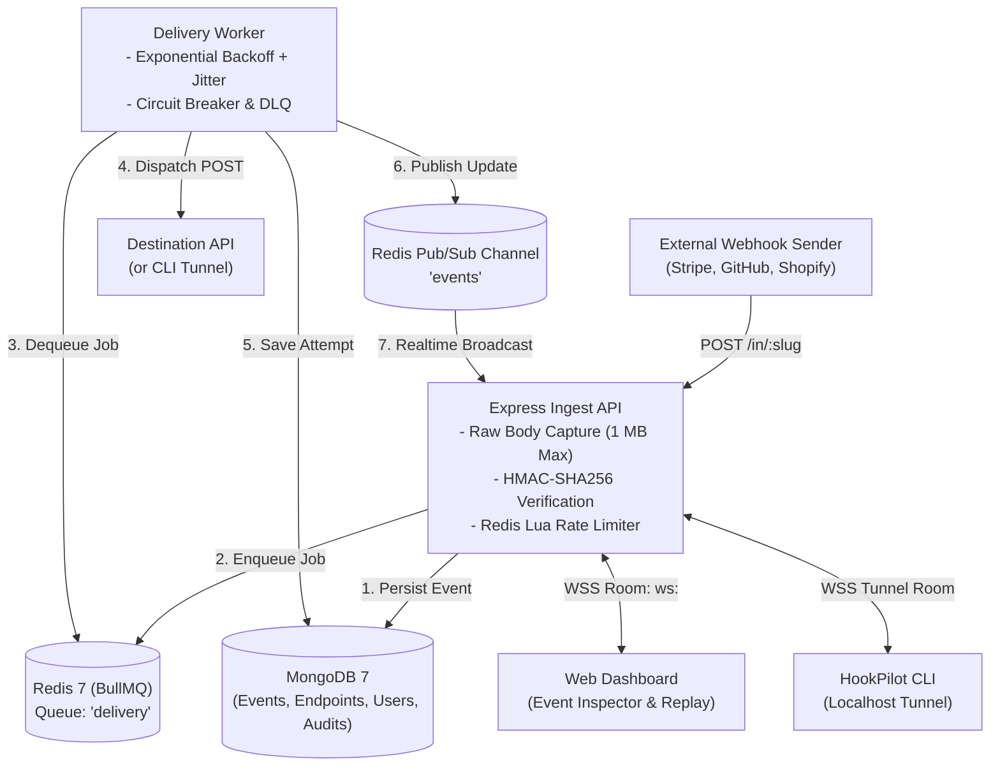

# HookPilot

[](https://github.com/Akshuu1/HookPilot/actions/workflows/ci.yml)
[](https://opensource.org/licenses/MIT)
[](https://nodejs.org/)
[](https://www.typescriptlang.org/)
[](vitest.config.ts)

A high-performance, enterprise-grade webhook reliability and debugging platform built with **MERN + TypeScript + Redis + BullMQ + Docker**.

HookPilot provisions unique ingest URLs (`/in/:slug`) that receive webhooks from any provider (Stripe, GitHub, Shopify, etc.), guarantees zero dropped deliveries with jittered exponential backoff retries, quarantines poison messages into a dead-letter queue (DLQ), and offers live event inspection and a developer CLI tunnel.

---

## 🚀 Key Features

* **Sub-Millisecond Ingestion**: Atomic Redis Lua sliding-window rate limiting sustaining **> 600 req/sec** with p95 latency under 108 ms.
* **Stream-Safe HMAC Verification**: Raw body capture prior to JSON mutation supporting Stripe, GitHub, Shopify, and generic providers.
* **Guaranteed Delivery Worker**: BullMQ job processing with jittered exponential backoff, circuit breaking, and dead-letter quarantine.
* **Realtime Inspection**: Web dashboard (React 18 + Vite + TanStack Query + Tailwind) powered by Socket.IO with multi-node Redis adapter.
* **Developer CLI Tunnel**: Localhost forwarding (`npx hookpilot listen 3000 --endpoint <slug>`) bypassing ngrok or remote tunnels.
* **Production Observability**: Built-in Prometheus metrics (`/metrics`), p50/p95/p99 latency aggregation, and provisioned Grafana dashboards.
* **Enterprise Security**: Strict SSRF prevention against private IPv4/IPv6 subnets, Helmet headers, CORS allowlist, and zero-secret log redaction.

---

## 🏛️ Architecture Overview



---

## 📦 Monorepo Layout (`npm` workspaces)

```text
hookpilot/
├── apps/
│   ├── api/            # Express REST, Ingest engine, Socket.IO, Prometheus metrics
│   ├── worker/         # BullMQ delivery processors, exponential backoff, DLQ
│   └── web/            # React 18 + Vite + Tailwind + TanStack Query + Zustand
├── packages/
│   ├── shared/         # Zod schemas, types, backoff math, SSRF guards
│   └── cli/            # HookPilot CLI tunnel client (`npx hookpilot`)
├── e2e/                # Playwright end-to-end webhook lifecycle verification
├── infra/              # docker-compose.yml, Prometheus, Grafana, k6 load scripts
├── scripts/            # Database seed script for public demo workspace
└── docs/               # Architecture decisions (ADRs) and load test reports
```

---

## ⚡ Quickstart

### Prerequisites
- **Node.js** >= 20.0.0
- **Docker & Docker Compose**

### 1. Clone & Install
```bash
git clone https://github.com/Akshuu1/HookPilot.git
cd HookPilot
npm install
```

### 2. Start Storage (MongoDB & Redis)
```bash
docker compose up -d mongo redis
```

### 3. Seed Demo Data & Sample Endpoints
Initialize a ready-to-test demo workspace with pre-populated endpoints, webhook events, and delivery timelines:
```bash
npm run seed
```

#### Demo Workspace Credentials:
* **Dashboard Login**: `demo@hookpilot.dev`
* **Password**: `Password123!`
* **Pre-configured Endpoints**:
  * `http://localhost:4000/in/stripe-payments` (Stripe)
  * `http://localhost:4000/in/shopify-orders` (Shopify)
  * `http://localhost:4000/in/github-actions` (GitHub)
* **Demo CLI Tunnel Key**: `hp_live_demokey_9876543210abcdef0123456789`

### 4. Run Development Servers
```bash
# Terminal 1: Ingest & Management API (Port 4000)
npm run dev:api

# Terminal 2: Delivery Worker Engine
npm run dev:worker

# Terminal 3: Web Dashboard (Port 5173)
npm run dev:web
```

---

## 💻 Developer CLI Tunnel

Receive live webhooks on your local workstation without configuring public DNS or router port-forwarding:

```bash
# 1. Login with your API key
npx hookpilot login --key hp_live_demokey_9876543210abcdef0123456789

# 2. Forward webhooks to local server running on port 3000
npx hookpilot listen 3000 --endpoint stripe-payments
```

---

## 🧪 Quality Gates & CI

HookPilot maintains strict automated quality gates enforced via GitHub Actions:

```bash
# Run unit & integration tests with coverage thresholds (services >= 80%)
npm test

# Run full end-to-end webhook lifecycle tests with Playwright
npm run e2e

# Run ramping k6 load test (0 -> 100 VUs)
npm run loadtest

# Strict code hygiene checks
npm run lint
npm run format:check
npm run typecheck
```

---

## 🚢 Production Deployment

For full cloud deployment instructions on **Render**, **Railway**, **Fly.io**, **Vercel**, **MongoDB Atlas**, and **Upstash Redis**, read the [Production Deployment Guide](docs/deployment.md).

Turnkey deployment configs included:
* [`render.yaml`](render.yaml) - Infrastructure-as-Code blueprint for Render.
* [`apps/web/vercel.json`](apps/web/vercel.json) - SPA routing configuration for Vercel.
* Multi-stage Dockerfiles:
  * [`apps/api/Dockerfile`](apps/api/Dockerfile)
  * [`apps/worker/Dockerfile`](apps/worker/Dockerfile)
  * [`apps/web/Dockerfile`](apps/web/Dockerfile)

---

## 📄 License
MIT
