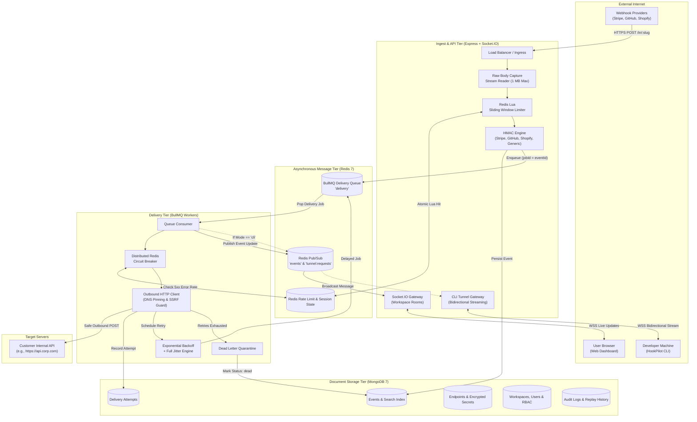

# HookPilot Deep Architecture Guide

HookPilot is a high-throughput, fault-tolerant webhook ingestion, transformation, and delivery gateway. It enables engineering teams to accept webhooks from external providers with guaranteed delivery, sub-second live observability, and developer-friendly local inspection.

---

## 1. High-Level System Architecture



---

## 2. End-to-End "Life of a Webhook"

The lifecycle of an inbound webhook spans seven deterministic stages:

### Stage 1: Public Stream Capture (`POST /in/:slug`)
1. An upstream webhook sender (e.g. Stripe) delivers an HTTP POST request to `/in/:slug`.
2. The `rawBodyCapture` middleware mounts before any JSON parser. It hooks into the readable stream (`req.on('data')`), calculates payload length, and stores the verbatim `Buffer` on `req.rawBodyBuffer`.
3. If payload size exceeds **1 MB**, the request is aborted immediately with HTTP 413, defending the node process against memory exhaustion attacks.

### Stage 2: Deduplication, Atomic Rate Limiting & Storage
1. The endpoint metadata and cryptographic signing secret are retrieved from MongoDB (cached in Redis).
2. The endpoint's sliding window rate limit is evaluated via an **atomic Redis Lua script** (`SLIDING_WINDOW_LUA`). This eliminates network round-trips and guarantees zero race-condition over-admission.
3. Cryptographic signature verification is executed against `req.rawBodyBuffer`:
   * **Stripe**: Parses `t=...,v1=...` timestamp and signature hash.
   * **GitHub**: Evaluates `sha256=...` HMAC in `X-Hub-Signature-256`.
   * **Shopify / Generic**: Evaluates base64 or hex hashes against configured header names.
4. The event document is persisted to MongoDB with initial status `queued`, storing raw headers, payload size, source IP, and synthesized text search tokens.

### Stage 3: BullMQ Job Scheduling
1. An asynchronous job is placed onto the BullMQ `delivery` queue in Redis.
2. The job ID is set deterministically:
   $$\text{jobId} = \text{eventId}$$
   This ensures that duplicate webhook transmissions arriving within the same ingestion window are deduplicated at the Redis queue layer.
3. The ingestion HTTP handler completes immediately with `HTTP 202 Accepted`:
   ```json
   { "eventId": "6ae23f170aafcc268d178f37" }
   ```
   **Ingestion SLA**: Completed in under 15 ms, isolating senders from downstream destination delays.

### Stage 4: Delivery Execution & Circuit Breaking
1. An available delivery worker pops the job from BullMQ and transitions the event status to `delivering`.
2. The worker inspects the endpoint's **Circuit Breaker** state in Redis:
   * If the circuit is `OPEN` (destination has failed 5+ consecutive times in 60s), the job fails fast without dispatching network packets, sparing downstream customer recovery.
   * If the circuit is `CLOSED` or `HALF_OPEN`, the worker proceeds to outbound dispatch.
3. **SSRF Guard & DNS Pinning**: The destination URL is validated against SSRF blacklists. The DNS lookup is performed, all resolved IPs are verified to be public routable IPs, and the socket connection is pinned to that IP.
4. The worker dispatches an HTTP POST request with original headers and payload:
   * **Success (HTTP 2xx)**: Records a successful `DeliveryAttempt`, resets circuit breaker failures, and marks event status as `delivered`.
   * **Transient Failure (HTTP 5xx, 429, or TCP timeout)**: Records a failed `DeliveryAttempt` and schedules a retry.

### Stage 5: Full-Jitter Exponential Backoff & DLQ Quarantine
1. If the attempt failed and `attemptNumber < endpoint.retryPolicy.maxAttempts`, the next delay is calculated using **Full Jitter**:
   $$T_{\text{delay}} = \text{random}\Big(0, \, \min\big(\text{maxDelay}, \, \text{baseDelay} \times 2^{\text{attempt}-1}\big)\Big)$$
2. The job is re-enqueued as a delayed job in BullMQ.
3. When `attemptNumber == maxAttempts`, all retries are exhausted. The event status is finalized as `dead` (quarantined in the Dead Letter Queue). Users can manually or bulk replay dead events once their service is restored.

### Stage 6: Distributed Real-Time Fanout
1. At every state change (`queued`, `delivering`, `delivered`, `failed`, `dead`), the delivery worker publishes an update message to the Redis `events` channel.
2. Every HookPilot API node subscribes to this channel. Upon receiving an update, it forwards the event to connected browser clients in Socket.IO room:
   ```text
   ws:<workspaceId>
   ```
3. The React Web Dashboard's TanStack Query virtualized table updates in real time (< 500 ms from ingest).

### Stage 7: Localhost CLI Tunnel Protocol
1. When a developer starts `hookpilot listen 3000 --endpoint <slug>`, the CLI establishes a persistent WebSocket connection to the API authenticated via an API Key.
2. The API sets a Redis tunnel key with a 15-second TTL:
   ```text
   tunnel:session:<endpointId> = <socketId>
   ```
3. When the delivery worker processes an event for an endpoint with an active CLI session, it publishes the event to Redis channel `tunnel:requests` instead of calling the public URL.
4. The CLI receives the payload, dispatches an HTTP POST to `http://localhost:3000`, captures the response status/headers/body, and streams a `tunnel:response` back through the socket to the worker.

---

## 3. Security Architecture & Threat Mitigation

| Threat Vector | HookPilot Defense Layer | Implementation Detail |
| :--- | :--- | :--- |
| **Server-Side Request Forgery (SSRF)** | Pre-flight DNS resolution & Outbound IP pinning | Resolves all A/AAAA records; validates against private, loopback, and cloud metadata CIDRs (`169.254.169.254`). |
| **Payload Tampering & Forgery** | Stream-level HMAC Verification | Captures unmutated raw byte buffer; verifies cryptographic signatures (Stripe, GitHub, Shopify, Generic). |
| **Denial of Service (DoS)** | Atomic Sliding-Window Rate Limiting | Pre-compiled Redis Lua script enforcing per-minute request limits with instantaneous HTTP 429 and `Retry-After`. |
| **Memory Exhaustion (Buffer Overflow)** | Ingest Stream Hard Cap | Intercepts incoming stream chunks and destroys connections exceeding 1 MB with HTTP 413. |
| **Data Leakage in Logs** | Deep Pino Redaction | Censors Authorization headers, cookies, API keys, signatures, secrets, and passwords across all log streams. |
| **Tenant Cross-Contamination** | Multi-Tenant Workspace RBAC | Strict object-level permissions (`owner`, `admin`, `member`, `viewer`) validated on all REST and WebSocket routes. |

---

## 4. Observability & Telemetry

HookPilot provides native telemetry out of the box:
* **Prometheus Metrics Endpoint (`/metrics`)**:
  * `ingest_requests_total`: Counter partitioned by `status`, `endpoint`, and `signature_valid`.
  * `ingest_duration_seconds`: Histogram measuring ingest pipeline response times.
  * `delivery_attempts_total`: Counter tracking outcomes (`delivered`, `failed`, `retry`, `dead`).
  * `queue_depth`: Gauge reflecting active BullMQ jobs waiting in Redis.
  * `dlq_size`: Gauge tracking quarantined dead-letter events.
* **Grafana Dashboards**: Provisioned JSON dashboards in `infra/grafana` visualizing ingestion rates, p50/p95 latency percentiles, and delivery success curves.
* **MongoDB Time-Series Analytics**: Aggregation queries using `$dateTrunc` and `$percentile` providing 1h, 24h, and 7d historical performance insights.

