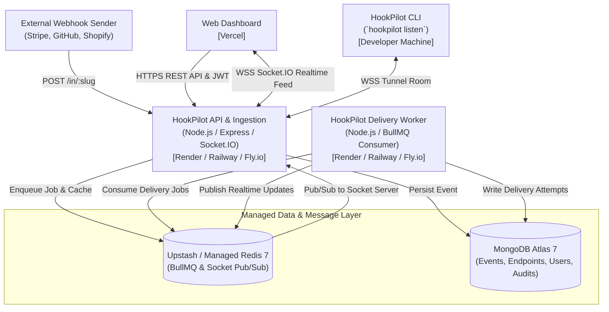

# HookPilot Production Deployment Guide

This guide covers end-to-end production deployment of HookPilot across modern cloud platforms:
* **Frontend Web Dashboard**: [Vercel](https://vercel.com)
* **API & Ingestion Service**: [Render](https://render.com), [Railway](https://railway.app), or [Fly.io](https://fly.io)
* **Delivery Worker Service**: [Render](https://render.com), [Railway](https://railway.app), or [Fly.io](https://fly.io)
* **Primary Database**: [MongoDB Atlas](https://www.mongodb.com/atlas)
* **Message Broker & Cache**: [Upstash Redis](https://upstash.com) or self-hosted Redis 7+

---

## 🏗️ Architecture Topology



---

## 1. Managed Databases Setup

### MongoDB Atlas
1. Create a free M0 cluster or serverless instance on [MongoDB Atlas](https://cloud.mongodb.com).
2. Create a Database User with read/write privileges (e.g. `hookpilot_app`).
3. Under **Network Access**, add `0.0.0.0/0` (or the static outbound IP ranges of your API & Worker hosts).
4. Copy the connection string:
   ```text
   mongodb+srv://hookpilot_app:<PASSWORD>@cluster0.abcde.mongodb.net/hookpilot?retryWrites=true&w=majority
   ```

### Upstash Redis
1. Create a Redis database on [Upstash](https://console.upstash.com).
2. Choose a region close to your API and Worker deployment.
3. In Database Details, copy the `rediss://` TLS connection URL.
   > [!NOTE]
   > BullMQ requires Redis commands without eviction on job queues. Ensure maxmemory policy is set to `noeviction` or default.

---

## 2. Frontend Deployment on Vercel

The frontend is a Vite Single-Page Application (SPA) located at `apps/web`.

### Step-by-Step
1. Import your GitHub repository into [Vercel](https://vercel.com/new).
2. Configure Project Settings:
   * **Framework Preset**: `Vite`
   * **Root Directory**: `apps/web` (or leave root and configure build command below)
   * **Build Command**: `npm run build --workspace=@hookpilot/web`
   * **Output Directory**: `dist` (or `apps/web/dist` if root is repository base)
   * **Install Command**: `npm install`
3. Environment Variables:
   | Variable | Value | Description |
   | :--- | :--- | :--- |
   | `VITE_API_URL` | `https://api.yourdomain.com` | Base public URL of your deployed HookPilot API |
4. Deploy. The included [`apps/web/vercel.json`](file:///Users/BADMSOH/HookPilot/apps/web/vercel.json) handles client-side routing rewrites (`/* -> /index.html`) and security headers.

---

## 3. API & Worker Deployment

### Option A: Render (Recommended Blueprint)
HookPilot includes a turnkey [`render.yaml`](file:///Users/BADMSOH/HookPilot/render.yaml) Blueprint.
1. In the [Render Dashboard](https://dashboard.render.com), click **New +** $\rightarrow$ **Blueprint**.
2. Connect your GitHub repository.
3. Render automatically provisions:
   * `hookpilot-api`: Web service running `apps/api/Dockerfile` on port 4000.
   * `hookpilot-worker`: Background worker running `apps/worker/Dockerfile`.
   * `hookpilot-redis`: Managed Redis service wired to both via private networking.
4. Supply your `MONGODB_URI` and update `CORS_ORIGIN` to match your Vercel URL.

### Option B: Railway
1. Create a New Project on [Railway](https://railway.app).
2. Add Service 1 (**API**):
   * Source: GitHub repo $\rightarrow$ Dockerfile: `apps/api/Dockerfile`
   * Networking: Expose Port `4000` $\rightarrow$ Generate Public Domain.
3. Add Service 2 (**Worker**):
   * Source: GitHub repo $\rightarrow$ Dockerfile: `apps/worker/Dockerfile`
   * No public domain required.
4. Add Service 3 (**Redis**):
   * Add Redis plugin or connect Upstash URL.
5. Set environment variables across both services.

### Option C: Fly.io
Deploy using Fly.io CLI:
```bash
# Deploy API
fly launch --dockerfile apps/api/Dockerfile --name hookpilot-api --internal-port 4000

# Deploy Worker
fly launch --dockerfile apps/worker/Dockerfile --name hookpilot-worker
```

---

## 4. Environment Variables Reference

### API Service (`apps/api`)

| Variable | Required | Default | Description |
| :--- | :---: | :--- | :--- |
| `PORT` | No | `4000` | HTTP and WebSocket listener port |
| `NODE_ENV` | Yes | `development` | Set to `production` in live environments |
| `LOG_LEVEL` | No | `info` | Pino log level (`info`, `warn`, `error`, `debug`) |
| `MONGODB_URI` | **Yes** | - | MongoDB connection URI (`mongodb+srv://...`) |
| `REDIS_URL` | **Yes** | - | Redis connection URL (`redis://` or `rediss://`) |
| `CORS_ORIGIN` | **Yes** | `http://localhost:5173` | Comma-separated list of allowed origins (e.g. `https://hookpilot.vercel.app,http://localhost:5173`) |
| `COOKIE_SAME_SITE` | No | `none` (in prod) | Cookie SameSite policy (`none` for cross-site, `lax` for same-site) |
| `JWT_ACCESS_SECRET` | **Yes** | - | 32+ character secret for signing short-lived access JWTs |
| `JWT_REFRESH_SECRET`| **Yes** | - | 32+ character secret for signing refresh tokens |
| `JWT_ACCESS_EXPIRES_IN` | No | `15m` | Access token lifespan |
| `JWT_REFRESH_EXPIRES_IN` | No | `7d` | Refresh token lifespan |
| `COOKIE_SECRET` | **Yes** | - | Secret string for signing cookies |
| `ENCRYPTION_KEY` | **Yes** | - | 64-character hex string (32 bytes) for AES-256-GCM endpoint secret encryption |
| `ALLOW_LOCAL_DESTINATION` | No | `false` | Set to `false` in production to enforce strict SSRF protection |

### Delivery Worker (`apps/worker`)

| Variable | Required | Default | Description |
| :--- | :---: | :--- | :--- |
| `NODE_ENV` | Yes | `development` | Set to `production` |
| `LOG_LEVEL` | No | `info` | Worker log verbosity |
| `MONGODB_URI` | **Yes** | - | MongoDB connection URI (must match API) |
| `REDIS_URL` | **Yes** | - | Redis connection URL (must match API) |
| `ENCRYPTION_KEY` | **Yes** | - | 64-char hex key to decrypt endpoint secrets for signing outbound webhooks |
| `WORKER_CONCURRENCY` | No | `10` | Number of simultaneous delivery jobs processed per worker instance |
| `ALLOW_LOCAL_DESTINATION` | No | `false` | Must remain `false` in production to prevent SSRF against internal services |

### Web Frontend (`apps/web`)

| Variable | Required | Default | Description |
| :--- | :---: | :--- | :--- |
| `VITE_API_URL` | **Yes** | `http://localhost:4000` | Full base URL of the deployed API service (without trailing slash) |

---

## 5. Security & Production Checklist

1. **Strict SSRF Protection**: Ensure `ALLOW_LOCAL_DESTINATION` is left unset or set to `false`. HookPilot resolves DNS and blocks deliveries to IPv4/IPv6 private ranges (`127.0.0.1`, `10.0.0.0/8`, `192.168.0.0/16`, AWS metadata `169.254.169.254`).
2. **Payload Size Guard**: Incoming webhooks on `/in/:slug` and JSON bodies are constrained to **1 MB**. Larger payloads are immediately rejected with HTTP 413 without memory exhaustion.
3. **Secret Redaction**: Pino loggers strictly censor passwords, API keys, tokens, HMAC secrets, and authorization headers across all log channels.
4. **HTTPS Everywhere**: Always deploy behind SSL/TLS termination. Cookie options default to `secure: true` in production with `sameSite: none` for cross-origin credentials.
5. **AES-256-GCM**: Generate a strong encryption key before booting:
   ```bash
   node -e "console.log(require('crypto').randomBytes(32).toString('hex'))"
   ```

---

## 6. Seed Demo Data in Production

To initialize your deployment with a demo user and sample endpoints:
```bash
MONGODB_URI="your-production-mongodb-uri" npm run seed
```
Demo access credentials:
* **Email**: `demo@hookpilot.dev`
* **Password**: `Password123!`
* **Endpoints**: `/in/stripe-payments`, `/in/shopify-orders`, `/in/github-actions`
